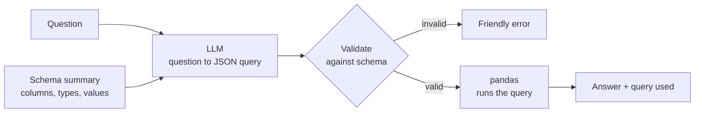

# llm-01 — LLM apps 

Two small LLM applications built on one principle: **the model handles language, the code handles correctness.** The model never does the maths and its output is never trusted blindly — it is validated before anything runs.

| Project | What it does | Prompting |
|---|---|---|
| [Ask your data](#ask-your-data) | Answers plain-English questions about a dataset with real numbers | Few-shot (4 examples), JSON output |
| [Pizza order bot](pizza-order-bot/) | Takes a pizza order in conversation and returns an itemised bill | One-shot, conversational |

Both run on a **local model via Ollama** (free) or the **OpenAI API**, switched with a `.env` setting — no code changes.

---

## Ask your data

Ask questions about the LendingClub loan dataset in plain English and get answers computed from the data, along with the query used to get them.

```
You: What's the average loan amount for borrowers who rent?
Bot: 13,240
     Query used: mean of loan_amnt where home_ownership == RENT
     [qwen2.5:1.5b | 2.1s | 812 in / 61 out tokens]

You: Will this borrower repay their loan?
Bot: I can't answer that from this data. Predicting individual outcomes needs a model, not a data query.
```
<!-- TODO: replace the example above with real output from your runs -->

### How it works



1. **Schema, not data.** The LLM sees only a short summary of the dataset: column names, types, numeric ranges and allowed category values. Free-text columns (names, addresses) are left out so the model can't filter on them.
2. **The LLM writes a query, not an answer.** A few-shot system prompt asks for a small JSON object: operation (`count`, `mean`, `sum`, `min`, `max`), column, filters, group-by and top-N — or `"answerable": false` with a reason.
3. **The code validates it.** Unknown columns, invalid operations, maths on text columns and category values that don't exist are all rejected with a clear message. Category values are matched case-insensitively (`rent` → `RENT`).
4. **pandas computes the answer.** No LLM-generated code is ever executed, and the user always sees the query behind the number.

### Design decisions

- **LLM decides, code computes.** Language models are unreliable at arithmetic; pandas is not. Splitting the work makes every number traceable.
- **LLM output is untrusted input.** It goes through the same validation as user input would.
- **Temperature 0** The same question gives the same query, which makes testing meaningful.
- **Provider-agnostic.** The OpenAI Python client talks to both Ollama and OpenAI through the same API, so models can be compared on identical code.

### Evaluation

20 test questions with answers computed independently in pandas, including questions the bot should decline. Each model's query was counted correct only if it produced the right answer (or correctly declined).

model,id,category,question,status,expected,got,query,seconds,in_tokens,out_tokens
qwen2.5-coder:7b,1,basic,How many loans are in the dataset?,PASS,396030,396030,"{
  ""answerable"": true,
  ""operation"": ""count"",
  ""column"": null,
  ""filters"": [],
  ""group_by"": null,
  ""top_n"": null,
  ""reason"": """"
}",15.9,887,47


                                 qwen2.5-coder:7b                 gpt-6-luna
Overall                                19/20 (95%)                 19/20 (95%)
  basic                                 4/4 (100%)                  4/4 (100%)
  filter                                5/5 (100%)                  5/5 (100%)
  multi_filter                           2/3 (67%)                   3/3 (100%)
  group_by                              4/4 (100%)                  4/4 (100%)
  decline                               4/4 (100%)                  4/4 (100%)
Avg latency                                  7.82s                       1.96s
Total tokens                 17,803 in / 1,269 out       17,030 in / 1,122 out

**Findings**

**Small models handle lookups, not reasoning**. The 1.5B local model did well on direct, single-step questions ("average loan amount for renters") but struggled with questions that need reasoning first, such as comparing groups or combining several conditions. Smaller models simply have less capacity for multi-step reasoning.
**Prompting helps with patterns, not with reasoning.** Few-shot examples taught the model the JSON format and the question types they showed, but they didn't make it reason better. Examples help a model copy; they don't add capability.
**Validation catches invalid queries, not wrong ones.** The safety layer turns bad columns and impossible operations into clear errors instead of wrong answers. A query that is valid but answers the wrong question still passes, which is why an evaluation set with known answers matters.
**Some failures are design limits, not model limits.** Questions outside the supported operations (ratios between two groups, trends over time) can't be answered by any model with this query format; the fix there is extending the format, not changing the model.

**What would improve it**

- Add few-shot examples for the question types that failed most often.
- Ask the model for a one-line plan of the query before the JSON.
- Route by difficulty: try the free local model first and fall back to a hosted model when validation fails.
- Fine-tune a small model on question-to-query pairs. it changes the model's weights, whereas prompting only changes its instructions

---

## Pizza order bot

A conversational order-taker: the model collects the order, the app validates it against the menu and calculates the bill. See [pizza-order-bot/README.md](pizza-order-bot/).

---

## Run it

Requires Python 3.10+ and [Ollama](https://ollama.com) (or an OpenAI API key).

```bash
conda create -n ask-your-data python=3.12 -y
conda activate ask-your-data
pip install -r requirements.txt
copy .env.example .env          # macOS/Linux: cp .env.example .env

ollama pull qwen2.5:1.5b
python app.py
```

Put the dataset in `data/` (CSV files there are git-ignored) and set `DATA_PATH` in `.env`. To use OpenAI instead, change `LLM_BASE_URL`, `LLM_API_KEY` and `LLM_MODEL` in `.env`.

## Project structure

```
app.py               chat loop: question → query → validate → answer
src/schema.py        summarises the dataset for the prompt
src/prompts.py       system prompt with few-shot examples
src/llm.py           one client for Ollama or OpenAI, logs time and tokens
src/query.py         validates the LLM's JSON and runs it with pandas
pizza-order-bot/     the second project
```

## Stack

Python · pandas · OpenAI Python SDK · Ollama · python-dotenv

---

## My AI engineering roadmap

Building in public — Technical Director transitioning to AI Engineer.

| Repo | Covers | Status |
|------|--------|--------|
| [ml-01-python-ml-foundations](https://github.com/srastogi2/ml-01-python-ml-foundations) | pandas, NumPy, visualisation, scikit-learn, TensorFlow | ✅ Done |
| [llm-01-ask-your-data](https://github.com/srastogi2/llm-01-ask-your-data) | LLM APIs, few-shot prompting, structured output, evaluation | ✅ Done |
| llm-02-rag-pipeline | LangChain, vector DBs, evaluation — data integration domain | 🔜 |
| llm-03-agent | LangGraph, tool use, MCP | 🔜 |

## License

MIT
